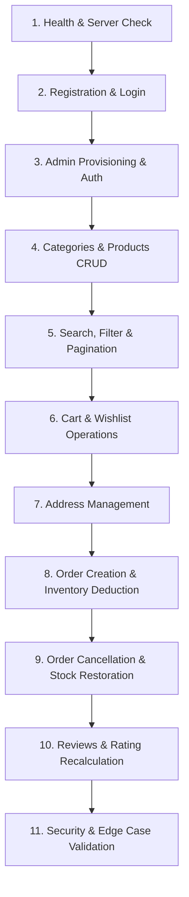

# Vilora Naturals — Backend Postman Verification Guide (V1)

This guide documents every REST API endpoint for the **Vilora Naturals** backend (Java 21, Spring Boot 3.5.5, Spring Security, JWT, Supabase PostgreSQL, and Cash on Delivery payment mode).

Accompanying Artifacts:
- **Postman Collection**: `Vilora_Naturals_V1.postman_collection.json`
- **Postman Environment Template**: `Vilora_Local.postman_environment.json`

---

## 1. Environment Setup

Import `Vilora_Local.postman_environment.json` into Postman and select **Vilora Naturals - Local Environment**.

### Postman Environment Variables
| Variable Name | Description | Default / Example Value | Set By / Notes |
| :--- | :--- | :--- | :--- |
| `baseUrl` | Backend application root URL | `http://localhost:8081` | Manual config |
| `customerToken` | JWT Bearer token for Customer | *Auto-populated* | Auto-set by Customer Login / Register |
| `adminToken` | JWT Bearer token for Administrator | *Auto-populated* | Auto-set by Admin Login |
| `categoryId` | UUID of test Category | *Auto-populated* | Captured from Category list or create |
| `productId` | UUID of test Product | *Auto-populated* | Captured from Product create |
| `cartItemId` | UUID of test CartItem | *Auto-populated* | Captured from Cart add item |
| `addressId` | UUID of test Address | *Auto-populated* | Captured from Address create |
| `orderId` | UUID of test Order | *Auto-populated* | Captured from Order create |
| `reviewId` | UUID of test Review | *Auto-populated* | Captured from Review create |

---

## 2. Recommended Test Sequence

Follow this end-to-end execution order to satisfy prerequisite state across endpoints:



---

## 3. Detailed Endpoint Catalog

### 1. Authentication & Profile

#### 1.1 Register Customer
- **Method**: `POST`
- **URL**: `{{baseUrl}}/api/auth/register`
- **Auth**: None (Public)
- **Request Body**:
  ```json
  {
    "fullName": "Kavita Sharma",
    "email": "kavita.customer@example.com",
    "password": "SecurePass123!",
    "address": "Flat 402, Sunshine Heights, Mumbai"
  }
  ```
- **Success Response** (`201 Created`):
  ```json
  {
    "success": true,
    "message": "User registered successfully",
    "data": {
      "token": "eyJhbGciOiJIUzI1NiJ9...",
      "type": "Bearer",
      "id": "c1f7a28e-5d1b-4f81-9b6d-71b312345678",
      "email": "kavita.customer@example.com",
      "roles": ["ROLE_CUSTOMER"]
    }
  }
  ```
- **Failure Cases**:
  - `400 Bad Request`: Email already registered, or validation error on empty fields.

#### 1.2 Login Customer
- **Method**: `POST`
- **URL**: `{{baseUrl}}/api/auth/login`
- **Auth**: None (Public)
- **Request Body**:
  ```json
  {
    "email": "kavita.customer@example.com",
    "password": "SecurePass123!"
  }
  ```
- **Success Response** (`200 OK`): Saves `customerToken`.
- **Failure Cases**:
  - `401 Unauthorized`: Bad credentials.

#### 1.3 Login Administrator
- **Method**: `POST`
- **URL**: `{{baseUrl}}/api/auth/login`
- **Auth**: None (Public)
- **Request Body**:
  ```json
  {
    "email": "admin@viloranaturals.com",
    "password": "AdminSecret2026!"
  }
  ```
- **Success Response** (`200 OK`): Returns `roles: ["ROLE_ADMIN"]` and saves `adminToken`.

#### 1.4 Get Profile
- **Method**: `GET`
- **URL**: `{{baseUrl}}/api/auth/me` (or `/api/auth/profile`)
- **Auth**: Bearer Token (`customerToken`)
- **Success Response** (`200 OK`):
  ```json
  {
    "success": true,
    "data": {
      "id": "c1f7a28e-5d1b-4f81-9b6d-71b312345678",
      "fullName": "Kavita Sharma",
      "email": "kavita.customer@example.com",
      "role": "ROLE_CUSTOMER"
    }
  }
  ```

#### 1.5 Update Profile
- **Method**: `PUT`
- **URL**: `{{baseUrl}}/api/users/profile`
- **Auth**: Bearer Token (`customerToken`)
- **Request Body**:
  ```json
  {
    "fullName": "Kavita S. Nair",
    "address": "Villa 12, Palm Meadows, Whitefield, Bengaluru",
    "phone": "9876501234"
  }
  ```
- **Success Response** (`200 OK`)

---

### 2. Categories Management

#### 2.1 List Categories
- **Method**: `GET`
- **URL**: `{{baseUrl}}/api/categories`
- **Auth**: None (Public)
- **Success Response** (`200 OK`): Array of active category objects.

#### 2.2 Create Category
- **Method**: `POST`
- **URL**: `{{baseUrl}}/api/categories`
- **Auth**: Bearer Token (`adminToken` — `ROLE_ADMIN` required)
- **Request Body**:
  ```json
  {
    "name": "Dry Fruits & Nuts",
    "description": "Premium organic nuts and sundried fruits",
    "active": true
  }
  ```
- **Success Response** (`201 Created`): Captures `categoryId`.
- **Failure Cases**:
  - `403 Forbidden`: If called using `customerToken`.
  - `409 Conflict`: Category with name already exists.

---

### 3. Products & Inventory Management

#### 3.1 Create Product with Inventory
- **Method**: `POST`
- **URL**: `{{baseUrl}}/api/products`
- **Auth**: Bearer Token (`adminToken` — `ROLE_ADMIN` required)
- **Request Body**:
  ```json
  {
    "name": "Mamra Almonds Premium Grade",
    "description": "Handpicked Iranian Mamra almonds rich in natural oil",
    "price": 899.00,
    "originalPrice": 1199.00,
    "stockQuantity": 25,
    "inStock": true,
    "organic": true,
    "categoryId": "{{categoryId}}",
    "ingredients": "100% Raw Mamra Almonds",
    "nutrition": "Protein 21g, Healthy Fats 49g, Fiber 12g per 100g",
    "image": "https://images.unsplash.com/photo-1508061253366-f7da158b6d46?w=600",
    "gallery": [
      "https://images.unsplash.com/photo-1508061253366-f7da158b6d46?w=600"
    ]
  }
  ```
- **Success Response** (`201 Created`): Returns product with `id` and `stockQuantity: 25`. Captures `productId`.
- **Failure Cases**:
  - `400 Bad Request`: `originalPrice` less than `price`, or negative `stockQuantity`.

#### 3.2 Search & Filter Products
- **Method**: `GET`
- **URL**: `{{baseUrl}}/api/products/search?search=Almonds&minPrice=100&maxPrice=1500&inStock=true&sort=price-asc&page=0&size=10`
- **Auth**: None (Public)
- **Success Response** (`200 OK`): Paginated `PageResponse<ProductResponse>` containing `content`, `totalElements`, `totalPages`.

#### 3.3 Update Product Stock / Details
- **Method**: `PUT`
- **URL**: `{{baseUrl}}/api/products/{{productId}}`
- **Auth**: Bearer Token (`adminToken`)
- **Request Body**:
  ```json
  {
    "name": "Mamra Almonds Premium Grade",
    "price": 849.00,
    "originalPrice": 1199.00,
    "stockQuantity": 30,
    "inStock": true,
    "organic": true,
    "categoryId": "{{categoryId}}"
  }
  ```
- **Success Response** (`200 OK`)

---

### 4. Shopping Cart & Wishlist

#### 4.1 Add Item to Cart (with Stock Validation)
- **Method**: `POST`
- **URL**: `{{baseUrl}}/api/cart`
- **Auth**: Bearer Token (`customerToken`)
- **Request Body**:
  ```json
  {
    "productId": "{{productId}}",
    "quantity": 2
  }
  ```
- **Success Response** (`200 OK`): Saves `cartItemId`.
- **Failure Cases**:
  - `400 Bad Request`: If `quantity` exceeds product's `stockQuantity` (e.g. `Insufficient stock available for 'Mamra Almonds Premium Grade'. Available: 30, Requested: 35`).

#### 4.2 View Cart
- **Method**: `GET`
- **URL**: `{{baseUrl}}/api/cart`
- **Auth**: Bearer Token (`customerToken`)
- **Success Response** (`200 OK`): Lists cart items with subtotal calculations.

#### 4.3 Add Product to Wishlist (Idempotent)
- **Method**: `POST`
- **URL**: `{{baseUrl}}/api/wishlist/{{productId}}`
- **Auth**: Bearer Token (`customerToken`)
- **Success Response** (`200 OK`)

---

### 5. Address Management

#### 5.1 Create Delivery Address
- **Method**: `POST`
- **URL**: `{{baseUrl}}/api/addresses`
- **Auth**: Bearer Token (`customerToken`)
- **Request Body**:
  ```json
  {
    "fullName": "Kavita S. Nair",
    "addressLine1": "Villa 12, Palm Meadows, Ramagondanahalli",
    "addressLine2": "Varthur Main Road, Whitefield",
    "city": "Bengaluru",
    "state": "Karnataka",
    "pincode": "560066",
    "phoneNumber": "9876501234",
    "isDefault": true
  }
  ```
- **Success Response** (`200 OK` or `201 Created`): Captures `addressId`.

---

### 6. Checkout, Orders & Inventory Control

#### 6.1 Create Order (Deducts Inventory Atomically)
- **Method**: `POST`
- **URL**: `{{baseUrl}}/api/orders`
- **Auth**: Bearer Token (`customerToken`)
- **Request Body**:
  ```json
  {
    "addressId": "{{addressId}}",
    "paymentMethod": "COD"
  }
  ```
- **Success Response** (`201 Created`):
  ```json
  {
    "success": true,
    "message": "Order created successfully",
    "data": {
      "id": "e4a3b2c1-...",
      "status": "PENDING",
      "paymentStatus": "PENDING",
      "paymentMethod": "COD",
      "subtotal": 1698.00,
      "shippingCharge": 0.00,
      "tax": 84.90,
      "totalAmount": 1782.90,
      "items": [
        {
          "productId": "{{productId}}",
          "productName": "Mamra Almonds Premium Grade",
          "quantity": 2,
          "price": 849.00
        }
      ]
    }
  }
  ```
- **Inventory Impact**: Atomically reduces product `stockQuantity` from 30 to 28. Row-level locks prevent concurrent overselling.
- **Cart Impact**: Clears the user's active cart.

#### 6.2 Cancel Order (Restores Inventory Atomically)
- **Method**: `POST`
- **URL**: `{{baseUrl}}/api/orders/{{orderId}}/cancel`
- **Auth**: Bearer Token (`customerToken`)
- **Success Response** (`200 OK`): `status` becomes `CANCELLED`.
- **Inventory Impact**: Product `stockQuantity` is restored from 28 back to 30.
- **Failure Cases**:
  - `400 Bad Request`: If order status is already `SHIPPED`, `DELIVERED`, or `CANCELLED`.

#### 6.3 Admin View All Orders
- **Method**: `GET`
- **URL**: `{{baseUrl}}/api/orders/admin`
- **Auth**: Bearer Token (`adminToken` — `ROLE_ADMIN` required)

#### 6.4 Admin Update Order Status
- **Method**: `PUT`
- **URL**: `{{baseUrl}}/api/orders/admin/{{orderId}}/status?status=SHIPPED`
- **Auth**: Bearer Token (`adminToken`)

#### 6.5 Admin Update Payment Status
- **Method**: `PUT`
- **URL**: `{{baseUrl}}/api/orders/admin/{{orderId}}/payment-status?paymentStatus=PAID`
- **Auth**: Bearer Token (`adminToken`)

---

### 7. Product Reviews

#### 7.1 Submit Review
- **Method**: `POST`
- **URL**: `{{baseUrl}}/api/products/{{productId}}/reviews`
- **Auth**: Bearer Token (`customerToken`)
- **Request Body**:
  ```json
  {
    "rating": 5,
    "comment": "Exceptional quality Mamra almonds, very crunchy and natural taste!"
  }
  ```
- **Success Response** (`201 Created`): Captures `reviewId`. Automatically recalculates product average `rating` and `reviewCount`.
- **Failure Cases**:
  - `400 Bad Request`: If the same user attempts to submit a second review for the same product.

#### 7.2 Update Review
- **Method**: `PUT`
- **URL**: `{{baseUrl}}/api/reviews/{{reviewId}}`
- **Auth**: Bearer Token (`customerToken`)

#### 7.3 Delete Review
- **Method**: `DELETE`
- **URL**: `{{baseUrl}}/api/reviews/{{reviewId}}`
- **Auth**: Bearer Token (`customerToken`)
- **Impact**: Recalculates product rating without the deleted score.

---

## 4. Security & Edge Case Checklist

| Scenario | Expected Result | Verified By |
| :--- | :---: | :--- |
| **Tampered / Expired Token** | `401 Unauthorized` | Handled by `JwtAuthFilter` |
| **Customer calling `/api/orders/admin`** | `403 Forbidden` | Enforced by `@PreAuthorize("hasRole('ADMIN')")` |
| **Customer viewing another user's order** | `403 Forbidden` / `SecurityException` | Verified in `OrderServiceImpl` |
| **Ordering more than available stock** | `400 Bad Request` / `IllegalStateException` | Handled by `OrderServiceImpl` |
| **Cancelling already shipped order** | `400 Bad Request` | Handled by `OrderServiceImpl` |
| **Duplicate review submission** | `400 Bad Request` | Handled by `ReviewServiceImpl` |
